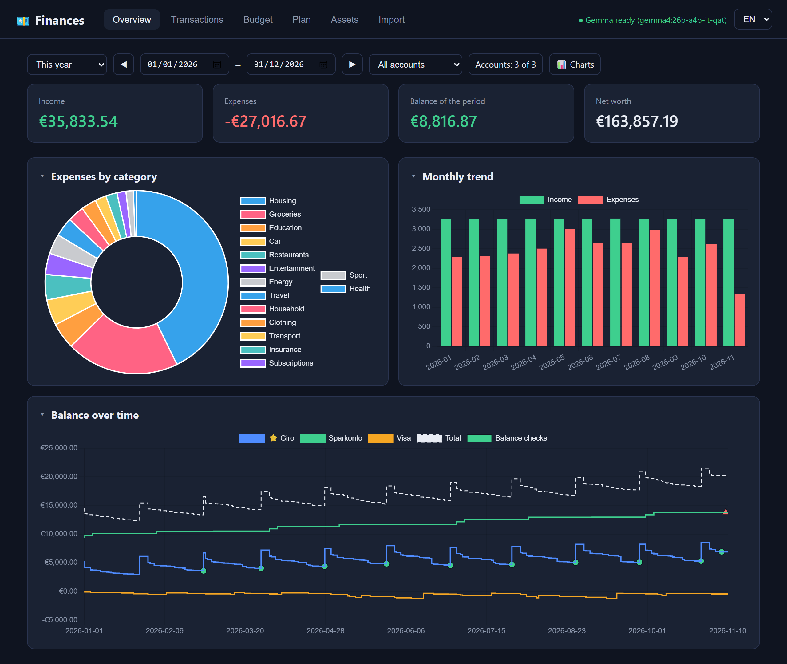
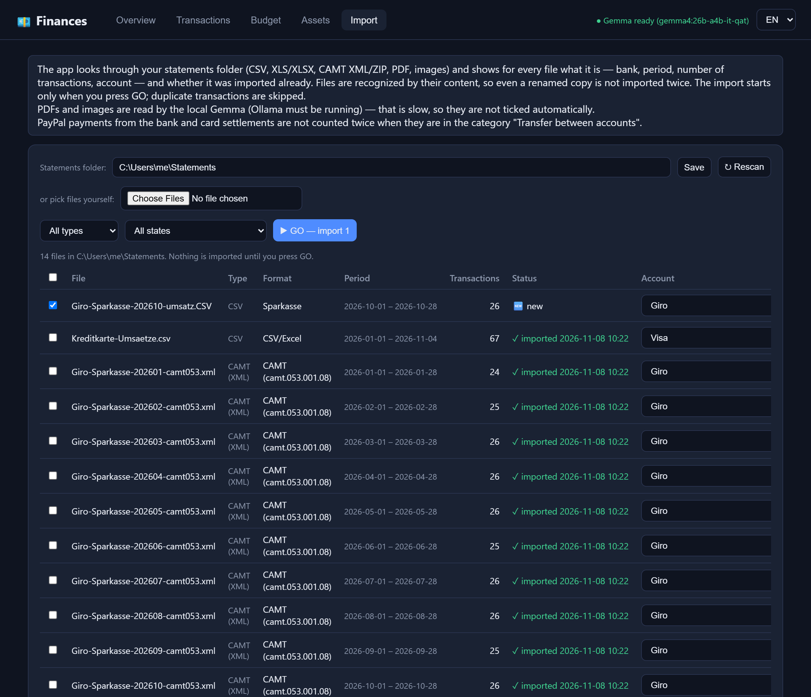
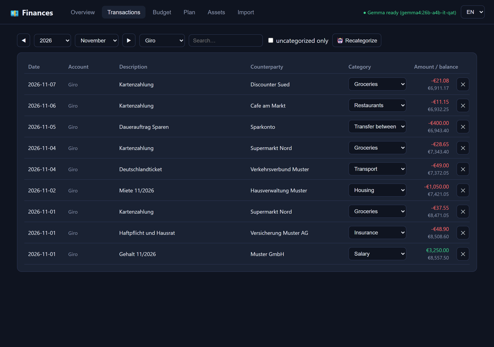
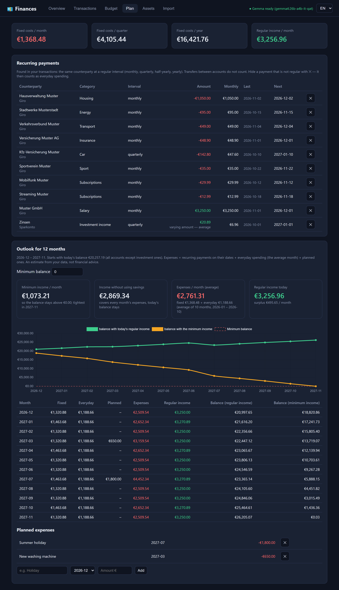
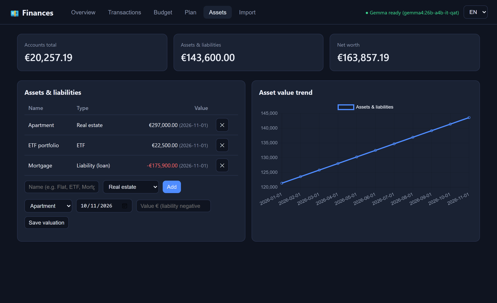

# Financie — local personal finance manager

Everything runs on your own computer. No bank connection, no data sent to third parties.
You download statements manually from internet banking and import them here.



<sub>All names and amounts in the screenshots are invented — they come from the demo
(`make demo`), never from real bank data.</sub>

**Made for German banks.** The recognized formats are those of German banks and
services (Sparkasse CSV and CAMT, PayPal DE, German credit cards), so the bank
texts in the screenshots — *Kartenzahlung*, *Miete*, *Dauerauftrag* — are German,
as they would be in your own statements. The interface itself is in English,
German or Slovak (switch at the top right). Other banks work when their CSV or
Excel columns have usual names, and CAMT is the European (ISO 20022) standard
that many banks offer as an export.

## How it works

- **SQLite database** (`financie.db`) — all data in a single file in the project folder. Back it up.
- **Web app** — runs at `http://localhost:8500`, for you only.
- **Gemma via Ollama (optional)** — a local AI model reads PDF statements, screenshots and scans, and suggests categories. CSV, Excel and CAMT (XML) files are parsed directly by code, without AI. All money math — totals, balances, checks — is plain code; the AI never computes it.

### Do I need the local AI?

No, not for the main use. Financie works without Ollama; the header shows
whether Gemma is ready.

| Without Gemma (no Ollama) | Needs Gemma |
|---|---|
| Import of CSV, Excel and CAMT (XML/ZIP) statements of the recognized formats, and of other CSV/Excel files whose columns have usual names (date, amount, description …) | Import of **PDF** statements and of **screenshots or scans** |
| Dedup, transfers, known balances, balance checks, charts, budget, assets, recurring payments and the outlook | A CSV/Excel layout whose columns the app cannot match by name (Gemma maps them) |
| Categories: you assign them, and the app **learns** from you — the next movement with the same counterparty gets the same category by itself, on import already | **🤖 Recategorize**: suggestions for movements the app has not learned yet |

So with CSV or CAMT exports from your bank you can skip Ollama entirely and
categorize by hand at first; the learned categories soon cover most of the
regular payments. A machine without a strong GPU is fine for that. Gemma helps
when a bank offers only PDFs, and to get through a long uncategorized history
quickly.

## Screenshots

| Import | Transactions |
|---|---|
|  |  |
| Every statement in the folder with its bank, period and account; nothing is imported before GO, and a file already imported is recognized by its content. | Categories you fix are learned; with one account chosen, every movement shows the balance after it, as in online banking. |

| Plan | Assets |
|---|---|
|  |  |
| Recurring payments found in the transactions (monthly, quarterly, yearly) and an outlook for the next twelve months: the income you need so the balance never drops below a floor you choose. | Accounts, assets and liabilities add up to the net worth; record a valuation now and then and the chart shows how it develops. |

## Try it with invented data

```bash
make demo
```

starts the app at `http://localhost:8501` on a throwaway database in a new
temporary folder, filled with invented accounts (a current account with CAMT
statements, a savings account and a credit card), a year of movements,
balance checks, budgets and assets. Your own database and statements folder
are never touched. The statements folder of the demo holds one CSV left to
import: pressing GO shows that movements already imported as CAMT are not
added twice. Running Financie, the demo included, needs my permission — see
[License](#license).

## Author

**Taras Bulubas** — taras.bulubas [at] gmail.com

**Use of AI.** Claude (an AI assistant by Anthropic) was used to help write
the code and the documentation, following my specifications and decisions.

**License.** © 2026 Taras Bulubas. All rights reserved; see [License](#license).

## Development environment

Requires Python 3.12 and GNU make 3.82+. No conda: the project uses its own
virtual environment `.venv` in the project folder.

All dependencies are declared in [pyproject.toml](pyproject.toml):

| Group       | Packages                                     | Used for                     |
|-------------|----------------------------------------------|------------------------------|
| runtime     | `fastapi`, `uvicorn`, `python-multipart`     | the web app and file uploads |
| runtime     | `openpyxl`, `xlrd`                           | XLSX and legacy XLS statements |
| runtime     | `pymupdf`                                    | PDF statements               |
| runtime     | `requests`                                   | the local Ollama API         |
| extra `dev` | `pytest`, `httpx2`                           | tests                        |

### Getting make on Windows

make is not part of Windows. Install it once, e.g. with

```bash
winget install ezwinports.make
```

or `choco install make` (from an administrator shell). Open a new terminal
afterwards so that `make` is on the `PATH`.

### Make targets

```bash
make venv
```

creates `.venv` with **Python 3.12** and installs the project in editable
mode with the `dev` extra. Running it again only reinstalls when
`pyproject.toml` or the `Makefile` has changed.

The version is pinned in the Makefile (`PYTHON_VERSION := 3.12`). On Windows
the base interpreter is found with the py launcher (`py -3.12`), elsewhere as
`python3.12`, so it does not matter which `python` comes first on the `PATH`
(Miniconda included). If `.venv` exists with another Python version,
`make venv` stops and asks for `make recreate`.

| Target               | What it does                                               |
|----------------------|------------------------------------------------------------|
| `make` / `make help` | list the targets                                           |
| `make venv`          | create `.venv` and install the project with all extras     |
| `make test`          | run the tests with pytest                                  |
| `make run`           | start the app at `http://localhost:8500`; another port with `ARGS="--port 8501"` |
| `make demo`          | try the app on invented data at `http://localhost:8501` (your database is not used) |
| `make clean`         | remove caches and build metadata                           |
| `make distclean`     | `clean` and remove `.venv`                                 |
| `make recreate`      | `distclean`, then `venv` — a fresh environment             |

`test` and `run` create the environment first if it does not exist. The
Makefile works from PowerShell, cmd and Git Bash on Windows as well as on
Linux/macOS.

### Without make

```bash
py -3.12 -m venv .venv
.venv/Scripts/python -m pip install -e ".[dev]"
```

(On Linux/macOS use `python3.12 -m venv .venv` and `.venv/bin/python`.)

### IntelliJ IDEA

See [docs/intellij.md](docs/intellij.md): register `.venv` as the project
interpreter and use the shared run configurations in `.run/` to run the
tests and the app.

### Ollama + Gemma

Install [Ollama](https://ollama.com/download/windows) and pull the model:

```bash
ollama pull gemma4:e4b
```

Optionally also `ollama pull gemma4:26b-a4b-it-qat` — a more accurate 26B MoE
model, about 15 GB, for a GPU with 16 GB of VRAM. Ollama is optional — see
[Do I need the local AI?](#do-i-need-the-local-ai).

### Reference machine

The project is developed and run on this laptop:

| Component | Specification                                              |
|-----------|------------------------------------------------------------|
| GPU       | NVIDIA GeForce RTX 5080 Laptop GPU, 16 GB GDDR7 VRAM       |
| CPU       | Intel Core Ultra 9 275HX, 24 cores                         |
| RAM       | 64 GB DDR5-5600 (2 × 32 GB)                                |
| Storage   | 2 TB NVMe SSD                                              |
| OS        | Windows 11 Pro                                             |
| Ollama    | 0.40.9                                                     |

Both models run on the GPU: `gemma4:e4b` (8.9 GB) leaves plenty of VRAM
free, `gemma4:26b-a4b-it-qat` (14.6 GB) just fits into the 16 GB. Smaller
GPUs work with `gemma4:e4b`; without a GPU Ollama falls back to the CPU,
which is much slower for PDF and image import.

## Usage

```bash
make run
```

or double-click `start.bat` (it uses `.venv` and opens the browser). Both run
`python -m financie` and serve `http://localhost:8500`.

### Import

Download statements from your banks into one folder (subfolders are fine) and
set it on the *Import* tab. Every time the tab opens, the app lists the files
there with the bank, period, number of transactions, the account they belong
to and their state: *new*, *imported* (with the time), *changed* (same name,
other content) or *failed*. Filter by file type (CSV, Excel, CAMT, PDF, images)
or state, tick what you want and press **GO** — nothing is imported before
that. You can still pick files by hand instead.

- **The right account by itself.** The account is remembered per source (bank
  account, card, PayPal), so the next download of the same source lands in the
  same account. A new source gets a proposed account; every account needs a
  name of its own.
- **Transfers between your accounts are found by themselves.** The same amount
  leaving one of your accounts and arriving on another within a week — a card
  repayment, a move to savings, a PayPal top-up — is a transfer on both sides, so it
  is neither income nor an expense. A category you set yourself is never changed.
- **No double counting.** Files are recognized by their content, so a renamed
  copy is never imported twice into one account. Overlapping statements are
  safe: transactions already there are skipped, also when another export format
  words them differently (see *Switching formats* below).
- **Nothing lost quietly.** When a statement has movements without an amount (the
  Sparkasse Excel export leaves some empty), the preview and the import result
  say how many rows were left out — use the CSV or CAMT export for that period.
- **Import history.** Every import is listed with its time and result, failed
  ones included. PDFs and images are read by Gemma, which words the same
  statement a little differently each time, so the history flags an import with
  **⚠ possible duplicates** (same date and amount as an earlier import; click it
  to see the pairs), and **↶** undoes a whole import — its transactions are
  deleted and the file counts as new again.

#### Supported statements

| Source | Format | Notes |
|---|---|---|
| Sparkasse (and other German savings banks) | CAMT XML / ZIP (camt.052, camt.053, any version) | **the best choice**: carries the bank's own booked balance for every day |
| Sparkasse | CSV-CAMT V2, camt52v8 CSV, MT940 CSV | pending rows ("Umsatz vorgemerkt") are left out until booked |
| Sparkasse | Excel `*-umsatz-camt52v8.xlsx` | readable, but leaves the amount of some movements empty — prefer CSV or CAMT |
| PayPal | activity CSV, balance report "Guthaben-relevante Zahlungen" | states the balance; funding from bank or card is a transfer |
| Barclays credit card | XLSX | only settled rows; the repayment from the bank is a transfer |
| Amazon Visa | XLS | |
| Credit card "Umsatz getätigt von …" | CSV | |
| any other bank | CSV / XLSX | columns recognized by name; Gemma maps unknown layouts |
| anything else | PDF, screenshot | read by Gemma (local) |

#### Switching formats

An account can switch between CSV and CAMT in both directions: a movement
already imported in the other format is recognized by its date and amount and
not added again, one to one. So months imported as CSV are not doubled by a CAMT
download, and a CSV downloaded after CAMT adds only what is new.

### Balances you can trust

Banks export only the last months, so a balance summed from the transactions is
rarely right. The app works with what the bank states instead:

- **Known balance.** Enter the real balance of an account once (✎ on the
  *Import* tab, e.g. today's balance from online banking, with its date): from
  then on the balance is that amount plus the later movements. Importing older
  statements never changes it. PayPal and CAMT statements state the balance
  themselves, so their first import sets it.
- **Balance checks (⚖).** Enter the balance the bank shows at the end of a day
  (the booked *Kontostand*, not the available amount) and the app says whether
  it matches to the cent or by how much it is off. Statements that state the
  balance are checked automatically on every day they cover — the Sparkasse
  CAMT download has one report per booking day, so a CAMT import checks every
  day and says from which day the app is off, if at all. The difference is
  computed live: importing a missing movement or deleting a doubled one clears
  it at once.
- **Unconfirmed balances are named.** An account without a known balance shows the
  sum of the movements you imported — for a card whose statement starts with a
  repayment of older purchases, that is a credit that does not exist. The net worth
  names such accounts until you enter their real balance (✎), and a credit card in
  credit is flagged on the *Import* tab.
- **Finding a difference.** Filter one account under *Transactions*: each
  movement shows the balance after it, as in online banking, so the day where
  the app and the bank part is easy to find.
- **Older history with holes.** Older statements can be imported even when the
  years in between are missing. Where the history has a hole (no movement for
  more than 45 days) and the statements before it state the bank's balance, the
  balances before the hole follow the bank's own figures instead of carrying the
  unknown movements of the hole; the app names the hole. A movement missing
  inside an otherwise complete period still shows as a difference, and today's
  balance never moves.

### Overview

Income, expenses by category and the monthly trend for a period.

- **Which accounts.** Mark the account your salaries go to as the main one (⭐ on
  the *Import* tab): the overview then shows it alone by default. Switch to
  *Satellite accounts* (PayPal, credit cards, … without the main one), *All
  accounts* or a custom choice. Transfers between accounts are never income or
  expenses; when only some accounts are shown, the money moved to or from the
  others appears as *Transfers to/from other accounts*, so the balance is the
  real change of those accounts. The overview warns when a chosen account has no
  data at the start of the period.
- **From a chart to the movements.** Click a slice of *Expenses by category* (the grey
  one is *Uncategorized*): *Transactions* opens with the same period, accounts and that
  category, ready to check or categorize; *Clear the filter from the overview* goes back
  to the usual lists.
- **Balance over time.** The end-of-day balance of each chosen account and their
  total, with the balance checks as points: ✓ where the app matches the bank, ⚠
  where it is off (hover for the figures). A line starts on the first day the
  account has data, never at zero, and breaks at a hole in the history.
- **Panels.** Like on a dashboard, each chart (and the summary figures) can be
  hidden or shown from the 📊 *Charts* menu and collapsed to its title by
  clicking it; the choice is remembered in the browser.
- **Offline.** Chart.js is bundled in `src/financie/static/vendor/`; the page
  loads nothing from the internet.

### Transactions

Review the automatic categories and fix what is needed. The app remembers your
corrections: next time it assigns the same counterparty by itself, without AI.

- **Your choice always wins.** The app records who chose each category — you, a
  format rule, the learning or the AI. When it learns, one correction of yours
  outweighs any number of AI guesses, and **🤖 Recategorize** fills only empty
  categories, never one that is set.
- **Change all at once.** When you change a category, the app offers to change it
  for the other movements of the same counterparty too — those without a category
  or set by a rule, the learning or the AI, never another choice of yours.
- **Check the AI.** Categories the AI guessed carry 🤖; *AI only* lists just those.
  The AI never marks anything as a transfer (transfers are left out of income and
  expenses, so only the rules and you decide that), and a movement it gives no
  answer for stays uncategorized.
- **The total of what you see.** Above the list: how many movements match the
  filter and their expenses, income and total (transfers between your accounts are
  shown apart and not counted) — for all of them, also when the list shows only the
  first rows.
- **Tags, e.g. for a trip.** Tick movements (or all shown), type a tag such as
  *Sardinia 2025* and press *Add tag*. A movement keeps its category and can carry
  several tags; tags never change what the app learns. Choosing a tag in the filter
  (or clicking 🏷 on a movement) shows all its movements across accounts and years —
  the flight booked months before included — with the total and the expenses by
  category: what the trip cost for travel, accommodation, restaurants, …
  ✎ renames a tag, ✕ deletes it (the movements stay).
- **A good start:** add your own categories (*Budget* tab), give one payment of
  each regular counterparty a category by hand (rent, salary, phone, insurance,
  donations, …), then press 🤖 Recategorize: the learned ones are filled in first,
  without AI, and Gemma only guesses the rest.
Pick the period with the year and month lists (*Whole year* shows all of it,
*All years* everything); ◀ ▶ move by a month, or by a year when the whole year
is shown.

### Plan

- **Recurring payments.** The app finds them in your transactions: the same
  counterparty paid at a regular interval — monthly, quarterly, half-yearly or
  yearly (a yearly one needs a little over a year of history). For each you see
  the current amount, a recent price change ("before €950"), what it costs per
  month, and when it is due next. The totals give your **fixed costs per month,
  quarter and year**, next to your regular income. Transfers between your own
  accounts do not count; payments that stopped are listed apart, and ✕ hides one
  that is not really recurring (it then counts as everyday spending).
- **Outlook for 12 months.** From the first of next month: the recurring payments
  on their due dates, the everyday spending of an average month (the mean of up to
  twelve complete months of the latest stretch of your data) and the extras you
  plan (a holiday, a washing machine). Starting from today's balance of all
  accounts except investment ones, it shows
  - the **minimum income per month** that keeps the balance above a floor you
    set (0 = no debt) in every month,
  - the **income without using savings**, which covers each month's expenses
    and leaves today's balance as it is,
  - and month by month the balance with your current regular income.

  Every figure is plain arithmetic on your own data, with its assumptions on the
  page — an estimate, not financial advice. No AI is involved.

### Budget and assets

- **Budget** — set monthly limits per category (Enter saves). The default
  categories (groceries, housing, internet and phone, donations, …) are translated
  into all three languages; add your own there too (*New category*). The app learns
  your own categories like the default ones, and Gemma gets them as well.
- **Assets** — add assets (apartment, ETF, crypto…) and liabilities (mortgage —
  enter a negative value). Record the current valuation from time to time; the
  chart shows how your net worth develops.

### Which format is this file?

```bash
.venv/Scripts/python -m financie inspect C:\Users\me\Downloads
```

lists every statement in a folder (or the given files) with its format,
encoding, header row, column names, the shape of the first values and whether
the importer recognizes it:

```
== umsaetze.csv
format:   CSV, encoding cp1250, delimiter ';'
header:   row 1 (0 rows above it)
columns:  Auftragskonto | Buchungstag | Valutadatum | … | Betrag | Waehrung | Info
mapping:  date=Buchungstag, amount=Betrag, description=Verwendungszweck, …
shape:    <text> | <date:%d.%m.%Y> | <date:%d.%m.%Y> | … | -99,99 | <text> | <text>
rows:     120, parsed 120, 2026-01-01 .. 2026-03-31
status:   ok
```

For a CAMT file it shows the message version, the number of daily reports and
entries, which fields they carry and whether the entries add up to the bank's
balances:

```
== Giro-camt52Booked.ZIP
format:   CAMT camt.052.001.08 (XML in ZIP, 34 files)
entries:  BOOK 80
balances: CLBD, OPBD
balance:  stated for 34 days, 2026-09-01 .. 2026-10-30, entries add up to the opening balance
status:   ok
```

When rows cannot be read, `unread:` and `types:` sum them up (how many lack an
amount or a date, whether they continue the row above, and generic booking types
such as `LASTSCHRIFT` only), and `formulas:` counts Excel cells whose value was
never stored.

Values appear only as shapes (`<date:…>`, `-9.999,99`, `<text>`, `<iban>`),
never as content, so the report can be shared to get a new bank format added.
Check the file names before sharing — some banks put the account number there.

## Privacy

Who sees your data: bank files and the database are processed only by your computer — deterministic Python code and local Gemma via Ollama. Nothing is sent to the cloud. Claude (in Cowork/Code) sees only the files in the folder you give it access to. To be sure, keep the database outside the shared folder:

```
set FINANCIE_DB=C:\Financie\financie.db
make run
```

And import statements from any other folder (e.g. Downloads) — you don't need to copy them into the shared one.

## Settings (optional)

A different model, Ollama address or default statements folder can be set via
environment variables:

```
set FINANCIE_GEMMA_MODEL=gemma4:26b-a4b-it-qat
set FINANCIE_OLLAMA_URL=http://localhost:11434
set FINANCIE_IMPORTS=C:\Users\me\Statements
make run
```

| Variable               | Default                   | Meaning                       |
|------------------------|---------------------------|-------------------------------|
| `FINANCIE_DB`          | `financie.db` in the project folder | the database file   |
| `FINANCIE_IMPORTS`     | none                      | default statements folder     |
| `FINANCIE_GEMMA_MODEL` | `gemma4:e4b`              | the Ollama model              |
| `FINANCIE_OLLAMA_URL`  | `http://localhost:11434`  | the Ollama API                |

The older names `GEMMA_MODEL` and `OLLAMA_URL` are still read when the
`FINANCIE_` ones are not set.

`FINANCIE_IMPORTS` is only the default: a folder saved on the *Import* tab
takes precedence, and clearing it there falls back to the variable.

## Tests

```bash
make test
```

The tests run against a throwaway database in a temporary folder, never
`financie.db`, and use invented sample statements only. Ollama is switched
off in them, so they check the deterministic parsing, dedup, learned
categories, transfer handling and balances on their own.

## Layout

```
src/financie/
  app.py              FastAPI routes and static serving
  db.py               schema, connection, balance and net-worth queries
  importer.py         statement parsing (CSV/XLSX/XLS/PDF/images), dedup, categorization
  gemma.py            Ollama client: structured JSON output, vision for scans
  cli.py              command line interface (python -m financie, inspect, demo)
  demo.py             invented accounts, statements and assets for the demo
  planning.py         recurring payments and the twelve-month outlook
  static/index.html   the whole frontend: markup, CSS, JS, i18n
  static/vendor/      Chart.js 4.4.4 with its MIT licence (no CDN)
tests/                parsing and API tests with invented data
scripts/              check_venv.py guards the Python version
docs/                 IntelliJ setup; images/ holds the README screenshots (demo data)
.run/                 shared IntelliJ run configurations
Makefile              environment and task shortcuts
start.bat             double-click launcher
financie.db           your data (created on first run, never committed)
LICENSE               all rights reserved
```

## License

© 2026 Taras Bulubas. **All rights reserved.**

This repository — code, documentation and images — is published for viewing
only. Using, running, copying, modifying or distributing any part of it
requires my prior written permission.

See [LICENSE](LICENSE) for the full terms.

**Would you like to use Financie?** I am glad to let people use it — ask me
first by e-mail at **taras.bulubas [at] gmail.com** (replace ` [at] ` with `@`), say briefly
what you would like to use it for, and you will get my answer in writing.
